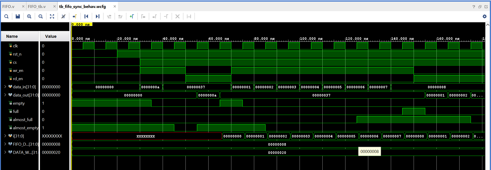

# Synchronous FIFO in Verilog

A parameterized **Synchronous FIFO** designed using Verilog HDL and simulated in **AMD Vivado XSIM**.

## Features

- Configurable FIFO depth and data width
- Read and write pointer implementation
- Full and Empty flags
- Almost Full and Almost Empty flags
- Active-low reset
- Protection against overflow and underflow

## Design Specifications

| Parameter | Value |
|---|---|
| FIFO Depth | 8 |
| Data Width | 32 bits |
| Clock | Single clock |
| HDL | Verilog |
| Simulation | Vivado XSIM |

## Simulation Waveform

The waveform shows FIFO write, read, fill and drain operations along with status flag transitions.

## Tools Used

- Verilog HDL
- AMD Vivado 2025.2
- Vivado XSIM

## Learning Reference

Developed with guidance from **FPGA Prototyping by Verilog Examples** by Pong P. Chu.

## Author

**Pranav Duse**

[GitHub Profile](https://github.com/Pranav-embedded) | [Project Repository](https://github.com/Pranav-embedded/FIFO)
